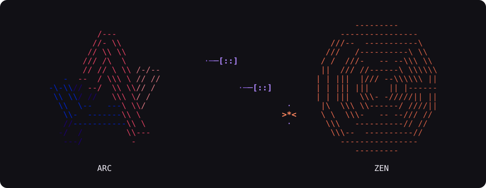

**Bring your browser with you.**

Move your Arc Spaces, tabs and browsing data into Zen with a guided terminal app for macOS. Choose everything or just what you need, review the transfer, and keep a full Zen backup for recovery.

## Start with one command

With Arc and Zen installed, paste this into Terminal:

```sh
curl -fsSL https://raw.githubusercontent.com/luntikius/arc-to-zen/main/install.sh | sh
```

Command opens the wizard, where you can select the options you want.

**Existing Zen data will be replaced. A full backup will be kept for recovery.**

ArcToZen asks for confirmation before replacement. It leaves your Arc data unchanged.

## From Arc to Zen, step by step

1. **Check your browsers.** Review the detected Arc and Zen installations.
2. **Choose what comes with you.** After discovering your profiles and Spaces, continue with a full migration or choose individual profiles, Spaces and data categories.
3. **Review the transfer.** See the selected data counts, skipped items and limitations. Confirm before replacing Zen.
4. **Move your data.** ArcToZen prepares and checks a separate Zen profile, saves a full backup, then installs the result. macOS may request Keychain access when transferring selected encrypted data.
5. **Make yourself at home.** Open Zen, enjoy the seamless migration.
  

Use **↑ / ↓** to navigate, **Space / Enter** to select, and **Esc** to go back. **Ctrl+C** requests cancellation at the next safe boundary. Changing your selection requires another scan and confirmation.

<details>
<summary>Watch the migration walkthrough</summary>


[View all interface screens](docs/INTERFACE.md).

</details>

## What moves

| Arc data | In Zen |
| --- | --- |
| Profiles | Separate containers, shown as **Profile** in Space settings |
| Spaces | Spaces linked to the matching container |
| Tabs and folders | Tabs, nested folders, order, Essentials, pinned tabs and compatible Split Views |
| Pinned addresses | Both the original pinned address and the current page |
| Themes and icons | Approximate native themes and supported Space/folder icons |
| Browsing history | Available visits with their dates, without a recent-months cutoff |
| Archived tabs | History entries when their source profile can be determined; tabs are not reopened |
| Passwords | Zen's encrypted password store |
| Cookies and sign-ins | Container-isolated cookies with supported security and partition attributes |
| Bookmarks and autofill | Bookmarks, form history, and supported addresses/payment cards through available Zen APIs |

You can turn categories off before scanning their data. Disabled categories are not read or decrypted. Profile/Space metadata is read first to build the selection screen.

History, passwords, cookies and other profile-level data cover the **whole selected Arc profile**. Selecting a single Space does not filter those records. Themes and icons require Spaces; archived history requires browsing history.

### How profiles work

All imported Spaces are available in **one Zen window**. Each Arc profile maps to a container; several Spaces can share that container.

**Cookies, site sessions and Essentials are separated by container. History and the password manager are shared.** These are native Zen containers, not separate browser installations or Firefox profiles.

### What stays behind

Chrome extensions and their data, Local Storage, IndexedDB, Service Workers, caches, Boosts, Easels, Arc sync state, and settings without a supported Zen equivalent are not transferred.

Some sites may still require you to sign in. Unsupported cookies are skipped rather than imported with weaker security settings. Themes are approximate and use native Zen controls; unsupported theme variants and icons may keep Zen's defaults. No custom CSS is installed.

Conflicting passwords for the same login, unknown required formats or encryption, unreadable required databases, or failed validation stop replacement. Originals remain available.

## Restore a backup

Choose **Restore from backup** in the wizard, either on the first screen or after migration. After the temporary tool has been removed, run the installation command again and choose the same option.

To open recovery directly:

```sh
curl -fsSL https://raw.githubusercontent.com/luntikius/arc-to-zen/main/install.sh | sh -s -- wizard --restore
```

Backups and recovery journals are kept in:

```text
~/Library/Application Support/ArcToZenMigration/<run-id>/
```

Keep the run ID and the entire run folder. **Open backup folder** on the recovery completion screen reveals the backup in Finder. Backups are not automatically deleted.

Zen must be closed to restore. If you have used Zen since migration, restoring requires an explicit confirmation: later changes will be removed from active Zen, while that current data is retained separately. Restore newer migrations first if several runs are stacked.

If an operation is interrupted, keep its journal and backup. Use the run ID shown in the error to reconcile it with `rollback --run <run-id>` before starting another migration.

## Requirements and compatibility

- An **Apple Silicon Mac**, with Terminal running natively. Intel and Rosetta are not supported.
- **macOS 11 or newer** for the bundled runtime; your browsers may require a newer version.
- Installed Arc and Zen, permission to read their data, and enough free disk space for staging and a full backup.
- Internet access to download the tool and runtime. Browser data is processed locally; temporary migration browsers start offline.

Compatibility is checked against actual data formats and installed Zen APIs. Unknown future versions are not assumed to work. ArcToZen does not modify or update browser applications.

## Command-line options

The launcher forwards arguments to the CLI. For example, inspect without replacing data:

```sh
curl -fsSL https://raw.githubusercontent.com/luntikius/arc-to-zen/main/install.sh | sh -s -- migrate --dry-run
```

Other commands include:

```text
inspect
migrate --dry-run
migrate --replace
verify --run <run-id>
rollback --run <run-id>
wizard --no-animation
wizard --restore
```

`migrate` also accepts `--profiles`, `--spaces` and `--categories`. Application/data path overrides go **before** the subcommand. Use `--help` or `migrate --help` for available flags. `--replace` explicitly authorizes replacement; the interactive wizard requires its own confirmation.

`inspect` and `migrate --dry-run` never request Keychain secrets or replace Zen. An interactive wizard needs terminal input; it will not silently replace data when no terminal is available.

<details>
<summary>Repair an earlier migration</summary>

- `repair-spaces --run <run-id>` combines older separate-profile migrations using current Zen data, including later changes.
- `repair-appearance --run <run-id> --dry-run` previews an appearance update from Arc.
- `repair-appearance --run <run-id>` updates supported themes/icons on matching original objects while retaining current tabs and other data.
- `repair-appearance --run <run-id> --reset-theme <space-uuid>` resets a matching Space to native Zen theme defaults.

Repair operations use the backup/recovery transaction. Unsupported required repair formats or conflicting passwords stop replacement. `rollback --force` explicitly allows restoring despite later changes; the replaced current data is retained separately.

</details>

## License

[MIT](LICENSE). An independent community tool, not affiliated with Arc or Zen Browser.
