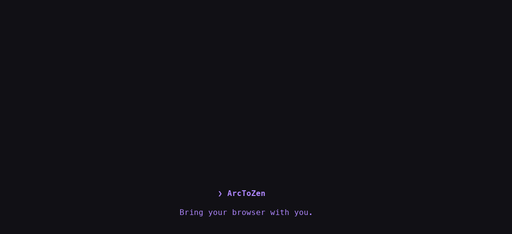
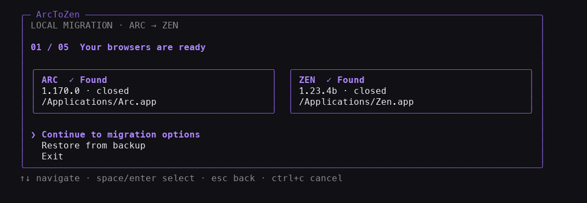
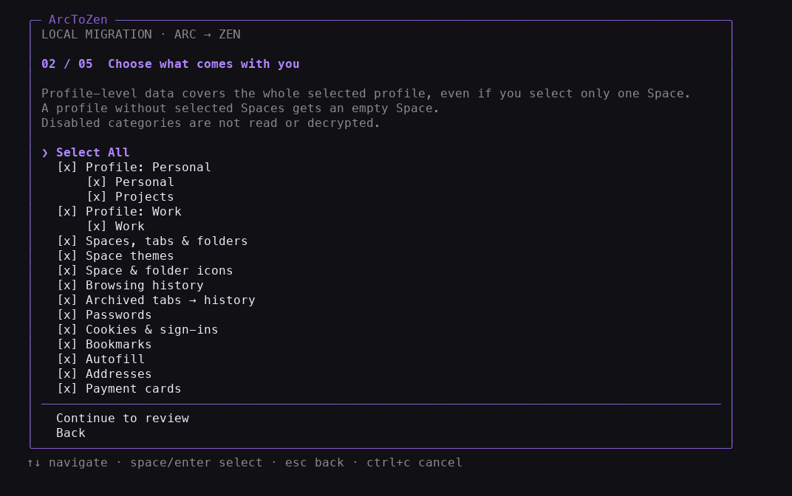
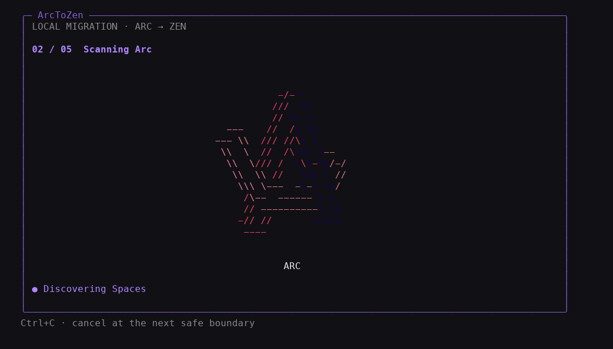
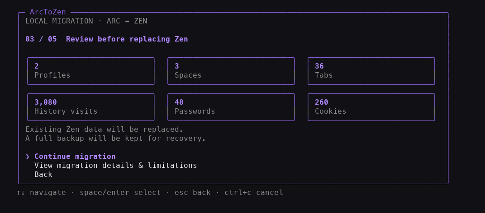
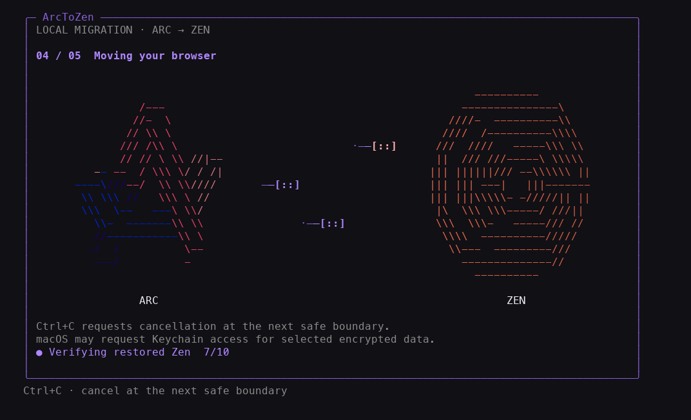
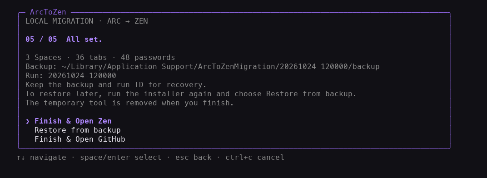

# ArcToZen interface preview

Captured from the actual terminal wizard in `--demo --dry-run` mode, using synthetic profiles and records. No real browser data, credentials or backups are shown. These captures are for release review; the public installation URL is not live yet.

## Walkthrough

## Startup

Bring your browser with you.

## Browsers

Review the detected browsers before continuing.

## Options

Choose the profiles, Spaces and data you want to bring.

## Scanning

Scan first. Review before replacing anything.

## Review

See what will move before you confirm.

## Transfer

Follow each stage while ArcToZen prepares and verifies your data.

## Completion

Finish and open Zen, restore a backup, or finish and open GitHub.

## Reproduce the capture

`scripts/capture_readme.py` launches only the synthetic wizard in a controlling PTY, decodes its actual ANSI output, and renders the terminal cells with Menlo. Developer-only dependencies are Pillow 13.0.0 and pyte 0.8.2; these are not migration runtime dependencies. Screens use a 104 × 42 terminal. The GIF is sampled at up to eight frames per second.

The capture script never opens real browsers, reads browser profiles or follows the final GitHub action. It exits the mock wizard with Esc after recording the completion screen.
